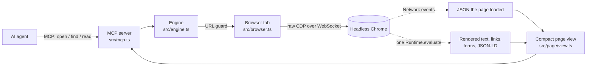

<div align="center">

# agentic-browser

**Any web page, as compact typed text for AI agents.**

An MCP server that drives Chrome over raw CDP and hands agents the page they asked for (rendered text, structured data, the JSON the page loaded, its forms) in one call, instead of a browser API to operate step by step.


</div>

---

## Why

Browser tools for agents expose a whole browser: 25 to 29 tools for clicking, typing, snapshots and tabs. This repo's benchmark measured where an agent's tokens go on reading tasks when every tool definition is loaded, and found that it isn't the page:

- On **Playwright MCP**, a median task takes 3 turns and ~26k tokens, but only ~2k characters of that is page content. Most of it is the tool definitions, ~8k tokens, re-sent on every turn.
- **Vercel agent-browser** sends ~22k tokens of tool definitions per turn, so it uses ~3x more tokens than Playwright MCP.

So one way to make agents cheaper and faster is **fewer, smaller tools and fewer turns**, not just smaller page dumps. agentic-browser has three read-only tools whose definitions total about 1,300 characters, and `open(url)` returns an answer-ready view, so most lookups take one call.

Read [What the benchmark does not show yet](#what-the-benchmark-does-not-show-yet) before quoting the numbers: the measured advantage depends on how the agent harness loads tool definitions, and the cheapest rival on reading tasks has not been measured.

## Status

| | |
|---|---|
| ✅ Benchmark | 60 tasks on 20 sites with a verified answer key; runner, scorer, report; two browser baselines measured, a no-browser baseline added but not yet run |
| ✅ Engine v0.1 | Raw CDP driver, JSON capture, `open` / `find` / `read`, MCP server, CLI, tests against real Chrome |
| ✅ Measured (v0.1b) | 95% success, 5,346 median tokens (4.9x fewer than Playwright MCP), 12.7 s median, one repeat |
| ✅ Engine v0.2 | Private-network guard, one-at-a-time opens, main-content start, JSON ranking, bounded search, `npx` entry point. 41 tests pass. **Not benchmarked yet** |
| 🔜 Next | Re-run the benchmark on v0.2 with the no-browser baseline and with tool search on; repeats 2-3; per-page-type map cache |
| ⏸️ Later | Actions (search, paginate, submit) with read/write/dangerous labels; diffs after each action; shared public-page maps |

## Quick start

Requirements: Node 22+ and Google Chrome.

```bash
git clone https://github.com/govindplal/agentic-browser && cd agentic-browser
npm install
npm run open -- "https://news.ycombinator.com/front?day=2016-03-15"   # print the view an agent gets
npm run open -- https://crates.io/crates/serde/1.0.100 --find downloads
npm run open -- http://localhost:3000 --allow-private                 # local pages are refused by default
```

Use it from any MCP client (Claude Code, Claude Desktop, Cursor, …):

```json
{
  "mcpServers": {
    "browser": { "command": "node", "args": ["/path/to/agentic-browser/bin/agentic-browser.js", "mcp"] }
  }
}
```

The package declares a `bin`, so once it is published (or the repo is public) this becomes `npx agentic-browser mcp`. It is not on npm yet.

| Flag or variable | Effect |
|---|---|
| `--allow-private`, `AGENTIC_BROWSER_ALLOW_PRIVATE=1` | Allow localhost and private-network pages (needed to read your own dev server) |
| `--headed` | Show the browser window |
| `AGENTIC_BROWSER_CHROME`, `CHROME_PATH` | Path to the Chrome binary |

### The three tools

| Tool | What it returns |
|---|---|
| `open(url)` | Title, URL, description, JSON-LD fields, a list of JSON responses the page loaded, its forms (method, action, field names), and ~3,000 characters of visible text, starting at the main content when the page marks one |
| `find(pattern)` | Case-insensitive regex over every visible text line, every link (with its URL), every loaded JSON value (`path = value`) and the JSON-LD |
| `read(from, length?)` | The next slice of the page text |

<details>
<summary>Example: <code>open("https://news.ycombinator.com/front?day=2016-03-15")</code></summary>

```text
# 2016-03-15 front | Hacker News
url: https://news.ycombinator.com/front?day=2016-03-15
form: GET https://hn.algolia.com/ ← q
text (first 2983 of 4051 chars):
Hacker Newsnew | past | comments | ask | show | jobs | submit | 2016-03-15	login

Stories from March 15, 2016
1.
	More code review tools (github.com/blog)
	624 points by Oompa on March 15, 2016 | 145 comments
2.
	Handful of Biologists Went Rogue and Published Directly to Internet (nytimes.com)
	492 points by srikar on March 15, 2016 | 169 comments
…
[more: read(from=2983); find(pattern) searches all text, links and JSON]
```

On crates.io the same call also lists the 8 JSON API responses the page fetched (`/api/v1/crates/serde/1.0.100`, downloads, owners, …), so version data can be read as typed values rather than scraped from markup.
</details>

## How it works



1. **Guard** the URL: refuse this machine and private networks unless allowed (see [Safety](#safety)).
2. **Navigate** with `Page.navigate`, wait for the load event, then wait until the network has been quiet for 500 ms (capped at 5 s). Connections that stay open by design (event streams, WebSockets, media, pings) do not hold up the wait.
3. **Capture JSON** from the `Network` domain: XHR, fetch or document responses with a JSON MIME type, up to 2 MB each after decoding. Up to 60 are considered and 20 kept, the page's own site first and analytics or consent calls last.
4. **Extract** the page in a single `Runtime.evaluate`: `innerText` (rendered text only), where the main content starts, headings, visible links, forms with labels, and JSON-LD.
5. **Render** a compact view (pure functions, unit-tested) and keep the full page in memory for `find` and `read`.

## What changed in v0.2

A review of v0.1 found gaps that the benchmark could not see, because its sites are friendly and its tasks arrive one at a time. Each fix below has a test.

| Gap in v0.1 | Fix in v0.2 |
|---|---|
| `open` accepted any URL, so a page could steer an agent to `http://localhost:…` or a cloud metadata address | Local and private addresses are refused before any request is sent, including numeric disguises (`http://2130706433`) and names that resolve inward. Redirect hops are checked too. Opt in with `--allow-private` |
| One shared tab: two parallel `open` calls raced, and a failed `open` left the previous page readable | Opens run one at a time; a failed open leaves no page behind |
| JSON capture kept the first 20 responses by arrival, so analytics could crowd out the page's data; the 2 MB limit was applied to the compressed size | Up to 60 candidates, ranked own-site first and trackers last; the limit applies to the decoded body |
| A page with an event stream always waited the full 5 s settle cap | Event streams, WebSockets, media and pings are not waited for |
| The first 3,000 characters were often site navigation | When the page has `<main>`, `role="main"` or `<article>` after 300+ characters of header, the view starts there and says how to read the header |
| `find` re-flattened every JSON document on every call and had no limits | Flattened lines are cached per page; patterns over 300 characters are refused; a search stops after 2 s and says its results are partial |
| Ran only from a cloned path through `tsx` | `bin/agentic-browser.js` and a `bin` entry in `package.json` |
| The report showed tokens but only a total cost | Median cost per task and cost against the baseline are reported next to tokens |
| No baseline without a browser | `plain-fetch`: one tool, plain HTTP, HTML to text |

## Safety

What the engine does, and what it does not.

- **Private networks are off by default.** Before navigating, the hostname is checked: `localhost`, loopback, private, link-local and carrier-NAT ranges are refused, for IPv4, IPv6 and IPv4-mapped forms, and for names whose DNS answer points inward. After loading, every redirect hop is checked by name, and (when no proxy is in use) the address Chrome connected to is checked as well.
- **Text hidden with `display:none` or `visibility:hidden` is dropped,** because the view is built from `innerText`. This is covered by an end-to-end test.
- **This is not protection against prompt injection.** Text hidden by other means (zero opacity, off-screen positioning, text the same colour as its background) is still returned. So are things a person never sees: the meta description, JSON-LD, captured JSON, and `aria-label` or `title` text used for links with no visible label. Screen-reader-only text is kept on purpose, since it often carries real data such as star ratings. Treat everything `open`, `find` and `read` return as untrusted page content.
- **Read-only.** There are no click, type or submit tools, and the tools are annotated `readOnlyHint`.

Limits of the guard:
- A redirect to a private address is refused, but the request that followed the redirect has already been sent. Nothing from it reaches the agent.
- Behind a proxy, Chrome reports the proxy's address for every connection, so the connected-address check is switched off when a proxy variable (`HTTPS_PROXY` and friends) is set. A system-wide proxy on a private address that is not in the environment will cause every page to be refused; use `--allow-private` there.
- Requests the page's own scripts make to private addresses are not blocked by this engine. Their JSON is not captured when the connected-address check is on.

## Architecture decisions

| Decision | Chosen | Instead of | Why |
|---|---|---|---|
| **Order of work** | Benchmark first, engine second | Building the engine and measuring later | The pitch is a number (about 10x fewer tokens than Playwright MCP). Measuring first showed most cost is tool definitions re-sent every turn, which changed the design before any engine code existed. |
| **Browser control** | Raw Chrome DevTools Protocol | Playwright or Puppeteer | Direct access to the `Network` domain (capturing the page's own JSON is central), no `Runtime.enable` (a common automation fingerprint), no bundled browser, and any CDP engine (e.g. Lightpanda) can replace Chrome later without touching the agent-facing layer. |
| **CDP transport** | Node's built-in `WebSocket` | The `ws` package | One less dependency; Node 22+ ships a standard WebSocket client. The whole CDP client is about 100 lines. |
| **Browser binary** | The installed Google Chrome, headless | Downloading a pinned Chromium | No 150 MB download on install, and the baselines use the same installed Chrome, so benchmark comparisons are like for like. |
| **Agent-facing surface** | 3 read-only tools, short descriptions | A full browser API (25–29 tools) | When definitions are loaded up front they are re-sent on every turn: measured at ~8k tokens per turn for Playwright MCP and ~22k for agent-browser. A small surface cuts that fixed cost. |
| **Page representation** | Compact text plus structured data | Accessibility-tree snapshots or screenshots | Snapshots are verbose and screenshots cost vision tokens. Rendered text with JSON-LD and the page's own JSON is usually answer-ready. |
| **Data source order** | The page's own JSON, then DOM text and forms | DOM only | Many sites receive their data as JSON before rendering it, and that JSON is already typed. This is step 2 of the spec's source order, after WebMCP. |
| **Which JSON to keep** | Rank by site, drop trackers last | First 20 by arrival | Analytics and consent calls usually fire first. Ranking uses the last two hostname labels as "same site" and a short tracker pattern; arrival order is kept inside each group. |
| **Large pages** | ~3k characters from the main content, plus `find` and `read` | Returning the whole page | The agent pulls only what it needs; `find` also searches links and JSON, so following a link or reading a value costs one small call. |
| **Hidden content** | `innerText` (rendered text only) | `textContent` or raw HTML | Drops `display:none` and `visibility:hidden` text. It does not stop other hiding tricks or invisible metadata; see [Safety](#safety). |
| **Network reach** | Public addresses only, opt-in for private | Any http(s) URL | An agent reading the web should not be steerable into the user's own network by the pages it reads. |
| **Concurrency** | One tab, opens queued | A tab per call | Agents often send tool calls in parallel. Queuing keeps each `open` result correct with no extra tool parameters; `find` and `read` act on the page opened last. |
| **Scope of v1** | Read-only, public pages | Clicks, forms, logins | The benchmark must beat Playwright MCP on reading before actions are worth building; read-only also removes the riskiest failure modes. |
| **MCP implementation** | Official `@modelcontextprotocol/sdk` | Hand-written JSON-RPC | Protocol correctness and version negotiation come for free; the server is about 70 lines. |
| **Benchmark agent** | Headless Claude Code (`claude -p`) with its own tools, settings and plugins off | A custom agent loop on the Anthropic SDK | It is a real agent harness people use, it runs on a Claude subscription, and stripping its context leaves only 761 tokens of fixed overhead, so token counts reflect the browser tool. |
| **Benchmark sites** | Scraping sandboxes, versioned or immutable pages, a Wayback snapshot | Popular live sites | Answers must not drift and pages must not block bots; every answer was verified against page HTML or the site's API, not written from memory. |
| **Long benchmark runs** | Repeat-major order with tools interleaved; a usage guard; `--resume` | Running tools one after another | A run that stops early (usage limit, low memory) is still a balanced comparison. The runner reads Claude Code's rate-limit events and stops before exhausting the subscription. |
| **Tests** | `node:test` with `tsx` | Vitest | No config, no extra dependencies; includes end-to-end tests against real headless Chrome and a local HTTP server. |

## Benchmark

60 reading tasks on 20 public sites (3 per site), each with a verified answer key in [`bench/tasks.json`](bench/tasks.json). Task kinds: lookup (30), aggregate across pages (14), JSON-loaded (7), interaction-dependent (3), navigate, search, JS-rendered and long documents.

Each run gives a headless Claude Code agent one task, a start URL and only the tool under test, mounted as an MCP server named `browser`. The agent must browse: runs that answer without a tool call are scored wrong.

### Results (2026-11-09, one repeat, `claude-sonnet-5-5`, headless Chrome)

| Tool | Runs | Success | Median tokens/task | Median s/task | Mean tool calls |
|---|---|---|---|---|---|
| Playwright MCP 0.0.84 | 60 | 95% | 26,402 | 14.3 | 3.0 |
| Vercel agent-browser 0.41.2 | 60 | 95% | 77,514 | 17.1 | 2.3 |
| **agentic-browser 0.1.0 (v0.1b)** | 60 | **95%** | **5,346** | **12.7** | **2.2** |
| plain-fetch (no browser) | not run yet | | | | |
| agentic-browser 0.2.0 | not run yet | | | | |

**4.9x fewer tokens** than Playwright MCP at the median, ~14x fewer than agent-browser, and a little faster (12.7 s against 14.3 s). The 10x target is not met. Interaction-heavy pages still cost about 20k tokens at the median.

The failures are the three openlibrary.org tasks for every tool: the site started showing headless browsers a human-verification page after the answer key was written (for agentic-browser's latest run they timed out on the connection). They say more about the site than about any tool, and the site needs replacing.

An earlier run of v0.1, before the interaction fixes, scored 98%, 5,385 tokens and 12.1 s. The per-run reports were generated locally and are not committed to this repository yet.

### What the benchmark does not show yet

These are the reasons not to quote 4.9x as a general result.

1. **Tool search was switched off.** Runs set `ENABLE_TOOL_SEARCH=false` so that every tool's definitions stay loaded and all tools are measured alike. Harnesses that load tool definitions on demand do not pay the ~8k (Playwright MCP) or ~22k (agent-browser) per turn that produces most of this gap. The same tasks need a run with tool search on.
2. **The cheapest rival is not in the table.** Every task is read-only on a site that does not block bots, which is where a one-tool fetch-to-text server is strongest. `plain-fetch` is now in `bench/` for this; it cannot run JavaScript, so the JS-rendered and JSON-loaded tasks are where a browser should earn its place. Lightpanda's MCP server (which has a markdown tool) and Microsoft's Playwright CLI are other fair comparisons.
3. **Tokens are not cost.** Re-sent tool definitions are prompt-cache reads, billed at about a tenth of the input price, so the cost gap is smaller than the token gap. Reports now show median cost per task and cost against the baseline.
4. **One repeat, uneven conditions.** The baselines ran at concurrency 3 and agentic-browser at 2. Three repeats under the same settings are needed before the medians mean much.
5. **v0.2 is unmeasured.** The main-content start and JSON ranking change what `open` returns. On the benchmark sites checked by hand (Wikipedia, Hacker News, crates.io, GitHub, pkg.go.dev) the header is short and the view is unchanged, but the numbers above belong to v0.1b until the run is repeated.
6. **Friendly sites only.** No bot checks, no logins, no cookie walls. On the open web, being blocked is a bigger problem than tokens, and this benchmark says nothing about it.

### Run it

```bash
npm run bench -- --tool agentic-browser,playwright-mcp --tasks bts-1,hn-1 --repeats 1          # quick check
npm run bench -- --tool playwright-mcp,agent-browser,agentic-browser,plain-fetch --concurrency 2  # all tasks x 3
npm run bench -- --resume results/<runId>                                                       # continue a stopped run
npm run bench:report -- results/<run-a> results/<run-b>                                         # merge and compare
```

Requires the Claude Code CLI (logged in) and Google Chrome. Runs use the logged-in subscription; the runner stops at 85% of the 5-hour usage window (`--stop-at`). A run records the engine version, and `--resume` refuses to mix versions, so v0.2 needs a fresh run.

## Prior art, and why this is not already done

Parts of it are. What is built here today overlaps with existing tools, and the parts that do not overlap are the hard ones.

| Idea | Who already does it | What is left |
|---|---|---|
| Fewer tokens from browser tools | Microsoft shipped Playwright CLI in early 2026 for coding agents, moving page state to disk and tool definitions out of the context; harnesses added on-demand tool loading | A small MCP surface still helps clients with neither |
| A page as text in one call | Fetch-to-markdown servers, Jina Reader, Firecrawl, Lightpanda's `markdown` tool | Nothing new in the text itself |
| The tool surface matters more than the engine | Lightpanda's own agent benchmark reached the same conclusion | Agreement, not a gap |
| Read the page's JSON instead of its DOM | ApiTap, site2cli and similar turn one site at a time into an API, set up ahead of time | Doing it live, for any page, with no setup, as `open` does |
| Sites declare tools for agents | WebMCP in Chrome | Needs each site to opt in and a visible tab |
| A shared map per page type; typed actions with risk labels; diffs after actions | Not found in a shipped open tool | The spec's actual bet, and not built here yet |

Why the last row is still open:
- **Maps need a model on the first visit** to name fields, and they break when a site changes its layout or runs an A/B test. The value only appears on repeat visits.
- **A shared map store is a trust problem.** A poisoned map could label "transfer money" as "search", so every map must be checked against the live page, and someone has to review contributions.
- **Blocking, not tokens, is the usual failure.** Bot checks, logins and CAPTCHAs stop real tasks before cost matters.
- **Incentives.** Hosted-browser vendors are paid per session or minute, so making each task cheaper is not their first priority, and the standards effort (WebMCP) puts the work on site owners.

So the wedge is repeat visits to the same page types (price tracking, job listings, package registries), where a cached map can make `open` return named fields with no model call.

## Project layout

```text
bin/agentic-browser.js    npx entry point
src/
  cdp/connection.ts       CDP client over the built-in WebSocket
  cdp/chrome.ts           find and launch installed Chrome
  net/guard.ts            refuse local and private addresses
  browser.ts              one tab: navigate, settle, capture JSON, extract
  page/extract-script.ts  in-page extraction (plain JS)
  page/json-rank.ts       which captured JSON to keep
  page/view.ts            open / find / read output (pure functions)
  engine.ts               transport-independent operations, open queue
  mcp.ts, cli.ts          MCP server and CLI
bench/
  tasks.json              60 tasks with answer checks
  src/                    runner (headless Claude Code), scorer, report
  src/plain-fetch.ts      no-browser baseline (one tool)
docs/
  spec.md                 product spec, review notes, measurements
```

## Development

```bash
npm test        # 41 tests: unit tests + end-to-end tests against headless Chrome
npm run lint    # typecheck (tsc --noEmit)
```

## Roadmap

1. Re-run the benchmark on v0.2 with `plain-fetch` in the table, three repeats, equal concurrency; add a run with tool search on. Replace openlibrary.org.
2. Per-page-type map cache: learn once which JSON fields and page regions hold the content, check the map cheaply on every load. Benchmark repeat visits, which is where it should win.
3. Typed fields from captured JSON (`price: 1299 (INR)`) rather than raw `path = value` lines.
4. Several pages in memory, so `find` can name the page it searches after parallel opens.
5. Actions from a small fixed vocabulary (search, filter, sort, paginate), each labelled read, write or dangerous, returning diffs.
6. Opt-in sharing of public-page maps (structure only, never content).

See [`docs/spec.md`](docs/spec.md) for the full product spec.

## License

[Apache-2.0](LICENSE)
