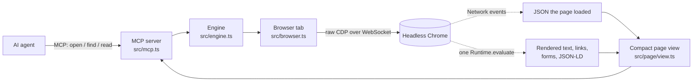

<div align="center">

# agentic-browser

**Any web page, as compact typed text for AI agents.**

An MCP server that drives Chrome over raw CDP and hands agents the page they asked for (rendered text, structured data, the JSON the page loaded, its forms) in one call, instead of a browser API to operate step by step.


</div>

---

## Why

Browser tools for agents expose a whole browser: 25 to 29 tools for clicking, typing, snapshots and tabs. This repo's benchmark measured where an agent's tokens actually go on reading tasks, and found that it isn't the page:

- On **Playwright MCP**, a median task takes 3 turns and ~26k tokens, but only ~2k characters of that is page content. Most of it is the tool definitions, ~8k tokens, re-sent on every turn.
- **Vercel agent-browser** sends ~22k tokens of tool definitions per turn, so it uses ~3x more tokens than Playwright MCP.

So the way to make agents cheaper and faster is **fewer, smaller tools and fewer turns**, not just smaller page dumps. agentic-browser has three read-only tools, with descriptions totalling a few hundred tokens, and `open(url)` returns an answer-ready view, so most lookups take one call.

## Status

| | |
|---|---|
| ✅ Benchmark | 60 tasks on 20 sites with a verified answer key; runner, scorer, report; two baselines measured |
| ✅ Engine v0.1 | Raw CDP driver, JSON capture, `open` / `find` / `read`, MCP server, CLI, tests against real Chrome |
| 🔜 Next | Full benchmark run of the engine; per-page-type map cache; typed fields from captured JSON |
| ⏸️ Later | Actions (search, paginate, submit) with read/write/dangerous labels; diffs after each action; shared public-page maps |

## Quick start

Requirements: Node 22+ and Google Chrome.

```bash
git clone https://github.com/govindplal/agentic-browser && cd agentic-browser
npm install
npm run open -- "https://news.ycombinator.com/front?day=2016-03-15"   # print the view an agent gets
npm run open -- https://crates.io/crates/serde/1.0.100 --find downloads
```

Use it from any MCP client (Claude Code, Claude Desktop, Cursor, …):

```json
{
  "mcpServers": {
    "browser": { "command": "npx", "args": ["tsx", "/path/to/agentic-browser/src/cli.ts", "mcp"] }
  }
}
```

### The three tools

| Tool | What it returns |
|---|---|
| `open(url)` | Title, URL, description, JSON-LD fields, a list of JSON responses the page loaded, its forms (method, action, field names), and the first ~3,000 characters of visible text |
| `find(pattern)` | Case-insensitive regex over every visible text line, every link (with its URL), every loaded JSON value (`path = value`) and the JSON-LD |
| `read(from, length?)` | The next slice of the page text |

<details>
<summary>Example: <code>open("https://news.ycombinator.com/front?day=2016-03-15")</code></summary>

```text
# 2016-03-15 front | Hacker News
url: https://news.ycombinator.com/front?day=2016-03-15
form: GET https://hn.algolia.com/ ← q
text (first 2983 of 4051 chars):
Hacker Newsnew | past | comments | ask | show | jobs | submit | 2016-03-15	login

Stories from March 15, 2016
1.
	More code review tools (github.com/blog)
	624 points by Oompa on March 15, 2016 | 145 comments
2.
	Handful of Biologists Went Rogue and Published Directly to Internet (nytimes.com)
	492 points by srikar on March 15, 2016 | 169 comments
…
[more: read(from=2983); find(pattern) searches all text, links and JSON]
```

On crates.io the same call also lists the 8 JSON API responses the page fetched (`/api/v1/crates/serde/1.0.100`, downloads, owners, …), so version data can be read as typed values rather than scraped from markup.
</details>

## How it works



1. **Navigate** with `Page.navigate`, wait for the load event, then wait until the network has been quiet for 500 ms (capped). This catches data that single-page apps fetch after load.
2. **Capture JSON** from the `Network` domain: every XHR, fetch or document response with a JSON MIME type is kept (up to 20 responses, 2 MB each).
3. **Extract** the page in a single `Runtime.evaluate`: `innerText` (rendered text only), headings, visible links, forms with labels, and JSON-LD.
4. **Render** a compact view (pure functions, unit-tested) and keep the full page in memory for `find` and `read`.

## Architecture decisions

| Decision | Chosen | Instead of | Why |
|---|---|---|---|
| **Order of work** | Benchmark first, engine second | Building the engine and measuring later | The pitch is a number (about 10x fewer tokens than Playwright MCP). Measuring first showed most cost is tool definitions re-sent every turn, which changed the design before any engine code existed. |
| **Browser control** | Raw Chrome DevTools Protocol | Playwright or Puppeteer | Direct access to the `Network` domain (capturing the page's own JSON is central), no `Runtime.enable` (a common automation fingerprint), no bundled browser, and any CDP engine (e.g. Lightpanda) can replace Chrome later without touching the agent-facing layer. |
| **CDP transport** | Node's built-in `WebSocket` | The `ws` package | One less dependency; Node 22+ ships a standard WebSocket client. The whole CDP client is about 100 lines. |
| **Browser binary** | The installed Google Chrome, headless | Downloading a pinned Chromium | No 150 MB download on install, and the baselines use the same installed Chrome, so benchmark comparisons are like for like. |
| **Agent-facing surface** | 3 read-only tools, short descriptions | A full browser API (25–29 tools) | Tool definitions are re-sent on every turn: measured at ~8k tokens per turn for Playwright MCP and ~22k for agent-browser. A small surface cuts that fixed cost. |
| **Page representation** | Compact text plus structured data | Accessibility-tree snapshots or screenshots | Snapshots are verbose and screenshots cost vision tokens. Rendered text with JSON-LD and the page's own JSON is usually answer-ready. |
| **Data source order** | The page's own JSON, then DOM text and forms | DOM only | Many sites receive their data as JSON before rendering it, and that JSON is already typed. This is step 2 of the spec's source order, after WebMCP. |
| **Large pages** | First ~3k characters plus `find` and `read` | Returning the whole page | The agent pulls only what it needs; `find` also searches links and JSON, so following a link or reading a value costs one small call. |
| **Hidden content** | `innerText` (rendered text only) | `textContent` or raw HTML | Text hidden with CSS, a common way to plant prompt injections, never reaches the agent (covered by an end-to-end test). |
| **Scope of v1** | Read-only, public pages | Clicks, forms, logins | The benchmark must beat Playwright MCP on reading before actions are worth building; read-only also removes the riskiest failure modes. |
| **MCP implementation** | Official `@modelcontextprotocol/sdk` | Hand-written JSON-RPC | Protocol correctness and version negotiation come for free; the server is about 70 lines. |
| **Benchmark agent** | Headless Claude Code (`claude -p`) with its own tools, settings and plugins off | A custom agent loop on the Anthropic SDK | It is a real agent harness people use, it runs on a Claude subscription, and stripping its context leaves only 761 tokens of fixed overhead, so token counts reflect the browser tool. |
| **Benchmark sites** | Scraping sandboxes, versioned or immutable pages, a Wayback snapshot | Popular live sites | Answers must not drift and pages must not block bots; every answer was verified against page HTML or the site's API, not written from memory. |
| **Long benchmark runs** | Repeat-major order with tools interleaved; a usage guard; `--resume` | Running tools one after another | A run that stops early (usage limit, low memory) is still a balanced comparison. The runner reads Claude Code's rate-limit events and stops before exhausting the subscription. |
| **Tests** | `node:test` with `tsx` | Vitest | No config, no extra dependencies; includes an end-to-end test against real headless Chrome and a local HTTP server. |

## Benchmark

60 reading tasks on 20 public sites (3 per site), each with a verified answer key in [`bench/tasks.json`](bench/tasks.json). Task kinds: lookup, navigate, search, aggregate (count or compare across pages), JS-rendered, JSON-loaded, long documents, and interaction-dependent pages.

Each run gives a headless Claude Code agent one task, a start URL and only the browser tool under test, mounted as an MCP server named `browser`. The agent must browse: runs that answer without a browser call are scored wrong.

### Baselines (2026-11-09, repeat 1 of 3, `claude-sonnet-5-5`, headless Chrome)

| Tool | Runs | Success | Median tokens/task | Median s/task | Mean tool calls |
|---|---|---|---|---|---|
| Playwright MCP 0.0.84 | 60 | 95% | 26,402 | 14.3 | 3.0 |
| Vercel agent-browser 0.41.2 | 60 | 95% | 77,514 | 17.1 | 2.3 |

All 6 failures are the openlibrary.org tasks, for both tools: the site started showing headless browsers a human-verification page after the answer key was written. Full report: [`docs/results/2026-11-09-baseline-rep1.md`](docs/results/2026-11-09-baseline-rep1.md).

### agentic-browser v0.1: first smoke run

One task (books.toscrape.com, a category lookup), one run: **correct, 13,820 tokens**, against 34,192 for Playwright MCP and 69,768 for agent-browser on the same task in the baseline run. It took 24.5 s against Playwright's 19.8 s. One run is an early signal, not a result; the full 60-task comparison is the next step.

### Run it

```bash
npm run bench -- --tool agentic-browser,playwright-mcp --tasks bts-1,hn-1 --repeats 1   # quick check
npm run bench -- --tool playwright-mcp,agent-browser,agentic-browser --concurrency 2   # all tasks x 3
npm run bench -- --resume results/<runId>                                              # continue a stopped run
npm run bench:report -- results/<run-a> results/<run-b>                                # merge and compare
```

Requires the Claude Code CLI (logged in) and Google Chrome. Runs use the logged-in subscription; the runner stops at 85% of the 5-hour usage window (`--stop-at`).

## Project layout

```text
src/
  cdp/connection.ts       CDP client over the built-in WebSocket
  cdp/chrome.ts           find and launch installed Chrome
  browser.ts              one tab: navigate, settle, capture JSON, extract
  page/extract-script.ts  in-page extraction (plain JS)
  page/view.ts            open / find / read output (pure functions)
  engine.ts               transport-independent operations
  mcp.ts, cli.ts          MCP server and CLI
bench/
  tasks.json              60 tasks with answer checks
  src/                    runner (headless Claude Code), scorer, report
docs/
  spec.md                 product spec, review notes, measurements
  results/                benchmark reports
```

## Development

```bash
npm test        # unit tests + end-to-end test against headless Chrome
npm run lint    # typecheck (tsc --noEmit)
```

## Roadmap

1. Full benchmark of v0.1 against both baselines; tune the view (text budget, link handling) on what fails.
2. Per-page-type map cache: learn once which JSON fields and page regions hold the content, check the map cheaply on every load.
3. Typed fields from captured JSON (`price: 1299 (INR)`) rather than raw `path = value` lines.
4. Actions from a small fixed vocabulary (search, filter, sort, paginate), each labelled read, write or dangerous, returning diffs.
5. Opt-in sharing of public-page maps (structure only, never content).

See [`docs/spec.md`](docs/spec.md) for the full product spec.

## License

[Apache-2.0](LICENSE)
